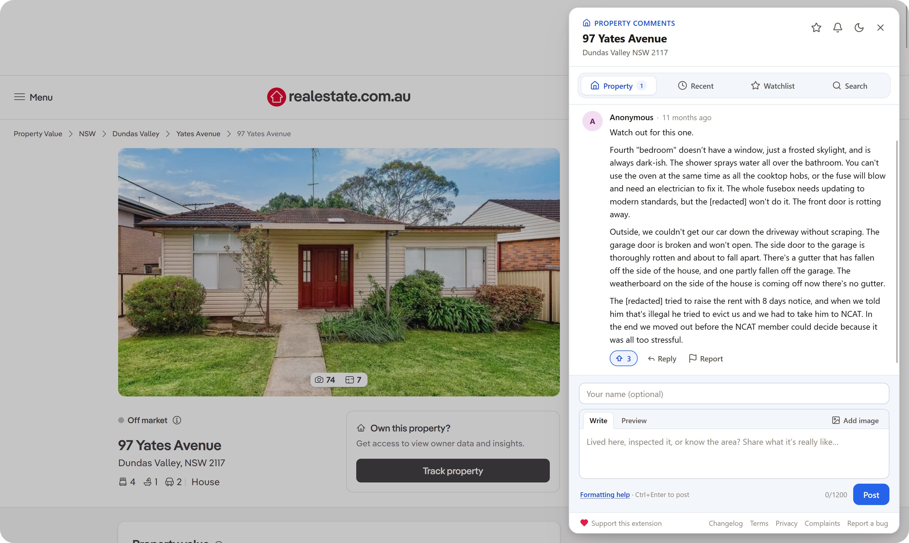

<div align="center">


<h1>Real Estate Comments</h1>

This browser extension adds a comment section to [realestate.com.au](https://www.realestate.com.au), [domain.com.au](https://www.domain.com.au) and [homely.com.au](https://www.homely.com.au) listings, so real renters and buyers can share their honest experiences and thoughts of a property, not just the agent's sales pitch.

<br />
</div>

# Installation

1. Install the extension from
   - **[Chrome Web Store](https://chromewebstore.google.com/detail/fpmhogbiebniapjfkbhgeacgkgpjaenn)**
   - **[Firefox Add-ons](https://addons.mozilla.org/en-US/firefox/addon/real-estate-comments/)**
2. Refresh any open realestate.com.au or domain.com.au tabs
3. Optional: to use it on [homely.com.au](https://www.homely.com.au) too, click the extension's toolbar button on a Homely listing (or **Sites** in the panel's footer) and allow access

# Usage

1. Open a property listing on [realestate.com.au](https://www.realestate.com.au), [domain.com.au](https://www.domain.com.au) or [homely.com.au](https://www.homely.com.au)
2. A comment button appears in the bottom-right corner, showing how many comments the property has
3. Click it to read comments, upvote helpful ones and post your own
4. Comments are shared between the sites, so a property has the same comments wherever you view it
5. Use the **Search** tab to find comments by address, street, suburb or postcode, without opening the listing

# Building from source

### Prerequisites

- Node 22.18 or newer (24 recommended)
- pnpm 11

### Steps

1. Clone and build the extension

```bash
git clone https://github.com/zevnda/real-estate-comments.git
cd real-estate-comments
pnpm install
pnpm build
```

2. Load the extension

- **Chrome**:
  - Go to `chrome://extensions/`
  - Enable `Developer mode`
  - Click `Load unpacked` and select `dist/chrome`
- **Firefox**:
  - Go to `about:debugging#/runtime/this-firefox`
  - Click `Load Temporary Add-on` and select `dist/firefox/manifest.json`

[Chrome Written Guide](https://developer.chrome.com/docs/extensions/mv3/getstarted/development-basics/#load-unpacked) | [Firefox Written Guide](https://developer.mozilla.org/en-US/docs/Mozilla/Add-ons/WebExtensions/Your_first_WebExtension#installing)

# Contributing

Bug fixes, new sites and improvements are welcome. See [CONTRIBUTING.md](CONTRIBUTING.md) for how to get started.
